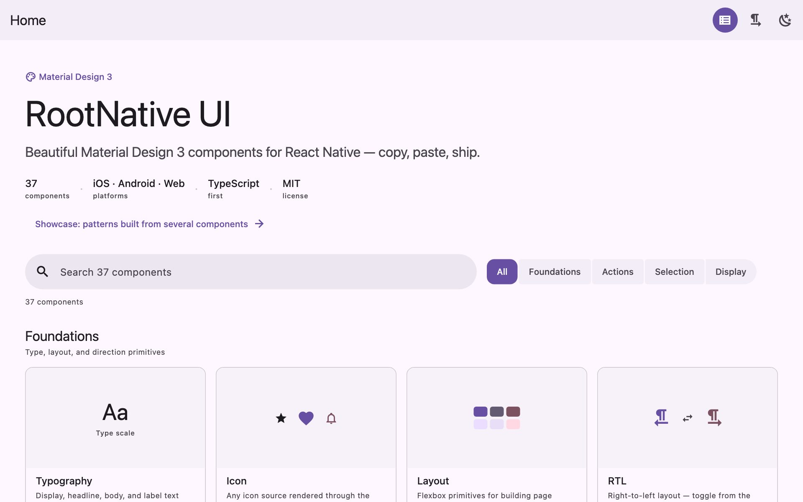
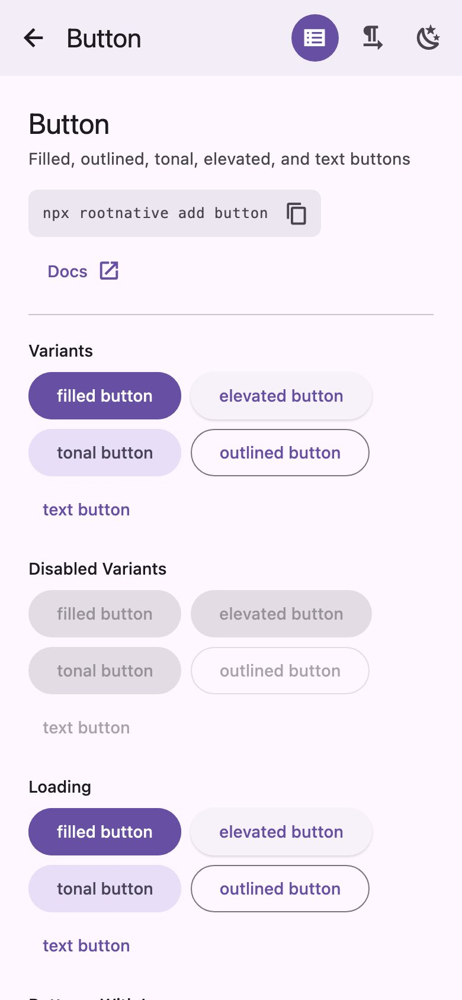
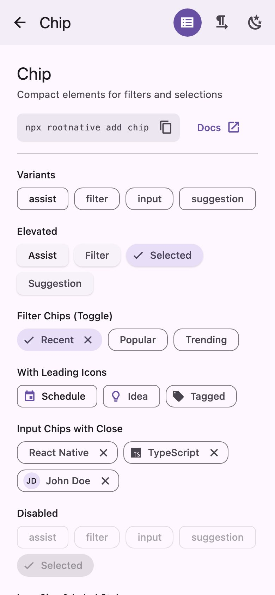
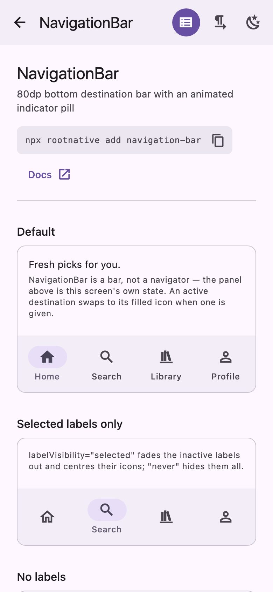
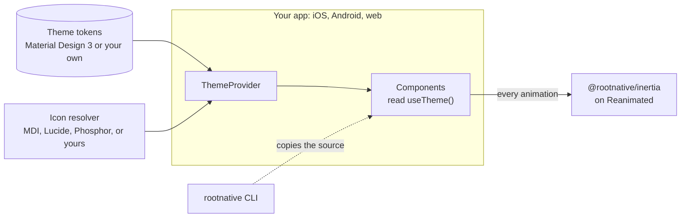

<p align="center">
  <a href="https://rootnative.github.io/ui/">
    <picture>
      <source media="(prefers-color-scheme: dark)" srcset="assets/brand/rootnative-mark-dark.svg" />
      
    </picture>
  </a>
</p>

<h1 align="center">Root Native UI</h1>

<p align="center">
  Components for React Native that follow your design system.<br />
  Material Design 3 is the default. One codebase for iOS, Android, and the web.
</p>

<p align="center">
  <a href="https://github.com/rootnative/ui/actions/workflows/ci.yml"></a>
  <a href="https://github.com/rootnative/ui/actions/workflows/deploy-web.yml"></a>
  <a href="https://github.com/rootnative/ui/actions/workflows/compat.yml"></a>
  <a href="https://www.npmjs.com/package/@rootnative/components"></a>
  
  
  
  <a href="LICENSE"></a>
</p>

<p align="center">
  <a href="https://rootnative.github.io/ui/demo/"><b>Open the live demo</b></a>
  ·
  <a href="#-try-it">Try it on a phone</a>
  ·
  <a href="#-quick-start">Quick start</a>
  ·
  <a href="https://rootnative.github.io/ui/">Documentation</a>
  ·
  <a href="https://rootnative.github.io/ui/llms-full.txt">LLM docs</a>
</p>

<p align="center">
  <picture>
    <source media="(prefers-color-scheme: dark)" srcset="assets/docs/screenshots/web-home-dark.jpg" />
    
  </picture>
</p>

## ✨ Features

| Feature | What it does |
| --- | --- |
| **More than 35 components** | Buttons, cards, chips, dialogs, menus, sheets, tabs, text fields, sliders, and navigation bars, rails, and drawers. Each one has its own subpath export. |
| **Any design system** | The theme engine takes your own tokens and your own theme type. Material Design 3 is only the default theme. |
| **A theme from one colour** | `createMaterialTheme('#006A6A')` makes a full Material light and dark theme from one seed colour. |
| **Light and dark** | Give `ThemeProvider` a light and a dark theme. It follows the system, and `useThemeMode()` lets the user choose. |
| **Expressive motion** | Spring transitions and a shape morph on press come from the Material 3 Expressive motion tokens. Each animation obeys the reduced-motion setting. |
| **Responsive layouts** | `useBreakpoint` and `useBreakpointValue` change a layout with the window width. The navigation bar, rail, and drawer cover each screen size. |
| **Any icon set** | One `iconResolver` prop renders each string icon name. Use MaterialDesignIcons, Lucide, Phosphor, SF Symbols, or your own SVGs. |
| **Accessible** | Each component sets its role, its label, and its state. On the web, dialogs, menus, and sheets keep the keyboard focus inside. |
| **Right to left** | Layouts mirror for right-to-left languages, on native and on the web. |
| **Ready for search engines** | `@rootnative/seo` writes the head tags, the JSON-LD, the sitemap, and the robots file of a static web export. |
| **Your own copy** | `npx rootnative add button` copies the source of a component into your project, with your import aliases. |
| **Docs for AI agents** | Each package ships an `llms.txt` file with the exact API of its version. |

## 📱 Try it

<p align="center">
  <picture>
    <source media="(prefers-color-scheme: dark)" srcset="assets/docs/screenshots/phone-button-dark.jpg" />
    
  </picture>
  &nbsp;
  <picture>
    <source media="(prefers-color-scheme: dark)" srcset="assets/docs/screenshots/phone-chip-dark.jpg" />
    
  </picture>
  &nbsp;
  <picture>
    <source media="(prefers-color-scheme: dark)" srcset="assets/docs/screenshots/phone-navigation-bar-dark.jpg" />
    
  </picture>
</p>

<table>
  <tr>
    <th width="50%">On a phone</th>
    <th width="50%">In a browser</th>
  </tr>
  <tr>
    <td align="center">
      
      <br />
      Scan with <b>Expo Go</b> on Android,<br />or with the <b>Camera</b> app on iOS.
    </td>
    <td align="center">
      <a href="https://rootnative.github.io/ui/demo/"><b>rootnative.github.io/ui/demo</b></a>
      <br /><br />
      Each component has its own page.<br />
      You do not need an install or an account.
    </td>
  </tr>
</table>

The QR code always serves the newest update from `main`. You do not need this
repository or a development server. The demo runs on Expo Go for SDK 58. Update
Expo Go if it reports a version mismatch.

<details>
<summary>The code does not scan?</summary>

<br />

Open this link on the phone:

```
exp://u.expo.dev/e13d4a03-0fe8-4f7f-97bb-5092bec13c51?runtime-version=0.0.0&channel-name=main
```

</details>

> [!TIP]
> The top bar of the demo switches between light and dark, and between
> left-to-right and right-to-left.

## 🚀 Quick start

Make a new app with the CLI:

```bash
npx rootnative create my-app
cd my-app
npx expo start
```

The CLI asks for the template, the display name, and the package manager. The
new app has `ThemeProvider` set up and a home screen to start from.

### Add it to an existing app

```bash
npm install @rootnative/core @rootnative/components
npx expo install react-native-safe-area-context react-native-svg react-native-reanimated react-native-worklets
npx expo install @react-native-vector-icons/material-design-icons expo-font   # optional: MaterialDesignIcons
```

npm and pnpm install the required peers, `@rootnative/inertia` among them.
`npx expo install` picks the versions that match your Expo SDK. Yarn 1 installs
no peers, so add each package in the
[installation guide](https://rootnative.github.io/ui/installation/) by hand.

Wrap the app in `ThemeProvider`:

```tsx
import { Button, Typography } from '@rootnative/components'
import { mdiResolver } from '@rootnative/components/mdi'
import { ThemeProvider, darkTheme, lightTheme } from '@rootnative/core'

export default function App() {
  return (
    <ThemeProvider
      theme={{ light: lightTheme, dark: darkTheme }}
      iconResolver={mdiResolver}
    >
      <Typography variant="headlineSmall">Hello</Typography>
      <Button variant="filled" leadingIcon="check">
        Save
      </Button>
    </ThemeProvider>
  )
}
```

> [!IMPORTANT]
> Each release line supports one Expo SDK band. An app on SDK 57 needs
> `0.0.0-alpha.28`. See [Expo SDK compatibility](#-expo-sdk-compatibility).

> [!TIP]
> Import from a subpath, such as `@rootnative/components/button`. Then the
> bundle loads only the components you use, and you need only their peers.

## 🧭 How it works



- **One theme contract.** Each component reads its colours, type, shape,
  spacing, elevation, and motion from `useTheme()`. A new design system is a
  new theme object, not a fork of the components.
- **One motion layer.** No component imports Reanimated directly. Each
  animation goes through [`@rootnative/inertia`](https://www.npmjs.com/package/@rootnative/inertia),
  so the reduced-motion setting applies everywhere.
- **Two ways to use a component.** Import it from npm, or copy its source into
  your project with `npx rootnative add` and change it as you like.

Read more in the [theming guide](https://rootnative.github.io/ui/theming/) and
the [motion guide](https://rootnative.github.io/ui/motion/).

## 📦 Packages

| Package | Install size | What it holds |
| --- | --- | --- |
| [`@rootnative/core`](packages/core) |  | The theme engine and its contracts, the Material Design 3 themes, `ThemeProvider`, `useTheme`, and the responsive hooks. |
| [`@rootnative/components`](packages/components) |  | The components, with one subpath export each. |
| [`@rootnative/icons`](packages/icons) |  | Icon resolvers for Lucide, Phosphor, and `@react-native-vector-icons/*`, with helpers for MaterialDesignIcons names. |
| [`@rootnative/seo`](packages/seo) |  | What a crawler reads from a web export: the head of each page, JSON-LD builders, headings, the HTML shell, the sitemap, and the robots file. |
| [`@rootnative/cli`](packages/cli) |  | The `rootnative` CLI. It makes a new app, or copies components into an app. |
| [`rootnative`](packages/rootnative) | — | A short name for `@rootnative/cli`, so `npx rootnative` works. |

## 📅 Expo SDK compatibility

Each release line supports one Expo SDK band. Install the line that matches the
SDK of the app.

| Expo SDK | `@rootnative/core`, `components`, `icons`, `seo` | `@rootnative/inertia` |
| --- | --- | --- |
| 58 | `0.0.0-alpha.29` and later | `0.0.20` and later |
| 57 | `0.0.0-alpha.16` to `0.0.0-alpha.28` (`npm install @rootnative/components@0.0.0-alpha.28`) | `0.0.11` to `0.0.19` |

## 🤖 Docs for AI agents

Each published package ships an [llms.txt](https://llmstxt.org/) file with the
exact API of its version, for example
`node_modules/@rootnative/components/llms.txt`. The docs site serves
[llms.txt](https://rootnative.github.io/ui/llms.txt), an overview, and
[llms-full.txt](https://rootnative.github.io/ui/llms-full.txt), the full API
reference. The [For AI agents](https://rootnative.github.io/ui/llms/) page has a
`CLAUDE.md` snippet to copy. An app from `rootnative create` already has it.

## 📚 Documentation

| Page | Read it to |
| --- | --- |
| [Introduction](https://rootnative.github.io/ui/introduction/) | See each component and what the library covers |
| [Installation](https://rootnative.github.io/ui/installation/) | Add the packages and their peers to an app, and set up `ThemeProvider` |
| [Quick start](https://rootnative.github.io/ui/quick-start/) | Make a new app with the CLI, and choose a template |
| [Theming](https://rootnative.github.io/ui/theming/) | Change the tokens, make a theme from one colour, or define your own design system |
| [Motion](https://rootnative.github.io/ui/motion/) | Learn the spring tokens and how the components animate |
| [Icons](https://rootnative.github.io/ui/icons/) | Use MaterialDesignIcons, Lucide, Phosphor, SF Symbols, or your own SVGs |
| [Fonts](https://rootnative.github.io/ui/fonts/) | Load your own fonts and use them in a theme |
| [Responsive](https://rootnative.github.io/ui/responsive/) | Change a layout with the window width |
| [Accessibility](https://rootnative.github.io/ui/accessibility/) | Learn the roles, the labels, and what is different on the web |
| [Web without Expo](https://rootnative.github.io/ui/web-without-expo/) | Use the library with Vite, webpack, or Electron |
| [SEO](https://rootnative.github.io/ui/seo/why/) | Make a web export that a search engine can read |
| [CLI](https://rootnative.github.io/ui/cli/) | Learn each command of the `rootnative` CLI |
| [API stability](https://rootnative.github.io/ui/api-stability/) | Learn which exports semver covers |

## 🧰 Tech stack

| Layer | Technology |
| --- | --- |
| Runtime | React 19.3, React Native 0.88, Expo SDK 58 |
| Motion | `@rootnative/inertia` on Reanimated 4.7 and Worklets 0.13 |
| Language | TypeScript 5, strict mode |
| Build | tsup for the packages, Turborepo for the tasks |
| Package manager | pnpm 10, with the workspace protocol |
| Tests | Jest 29 and `@testing-library/react-native`, Vitest for the CLI |
| Docs | Docusaurus 3 |
| Delivery | GitHub Actions, GitHub Pages, EAS Update, and npm |

## 🔧 Development

You need Node.js 24 (the version in `.nvmrc`) and pnpm 10.

```bash
git clone https://github.com/rootnative/ui.git
cd ui
pnpm install
```

| Command | What it does |
| --- | --- |
| `pnpm run build` | Builds each package with Turborepo |
| `pnpm run check` | Runs the lint and the type check |
| `pnpm run test` | Runs the tests of each package |
| `pnpm run format` | Formats the code with Prettier |
| `pnpm run example` | Starts the Expo dev server of the example app |
| `pnpm run docs:dev` | Starts the docs site. The first run exports the example app for the demo on the home page. |
| `pnpm run clean` | Removes the build output |

To start the example app on one platform, run
`pnpm --filter example ios`, `android`, or `web`.

<details>
<summary>Repository layout</summary>

```text
.
├── docs/                  # Docusaurus documentation site
├── example/               # Expo Router app, also the live demo
├── packages/
│   ├── core/              # Theme engine and provider
│   ├── components/        # The components
│   ├── icons/             # Icon-library adapters for the iconResolver
│   ├── seo/               # Head, JSON-LD, headings, shell, sitemap for the web export
│   ├── cli/               # The rootnative CLI
│   ├── rootnative/        # Short name for the CLI
│   └── utils/             # Internal helpers, bundled into components (not published)
├── templates/             # Templates for `rootnative create`
│   ├── blank/
│   └── with-router/
├── registry/              # Generated component metadata for the CLI
├── scripts/               # Generators (registry, llms.txt, brand) and checks
├── turbo.json
└── pnpm-workspace.yaml
```

</details>

## 🤝 Contributing

Read [CONTRIBUTING.md](CONTRIBUTING.md) before you open a pull request.

## 🙏 Credits

- The default theme follows [Material Design 3](https://m3.material.io/) by
  Google.
- [`@material/material-color-utilities`](https://github.com/material-foundation/material-color-utilities)
  makes the colour roles of `createMaterialTheme`.

## 📄 License

[MIT](LICENSE) © 2025 Root Native
