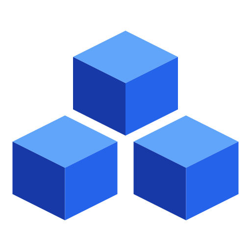

<!--
  Absolute URL, not a relative path: this README is the npm package page, and
  npm does not resolve repository-relative image paths.
-->


# @rootnative/core

The theme engine of [Root Native UI](https://github.com/rootnative/ui), a React Native component library. It works with any design system, and ships with Material Design 3.

## Install

```bash
pnpm add @rootnative/core @rootnative/inertia
```

Peer dependencies: `react >=19.3.0`, `react-native >=0.88.0 <0.89.0`, `@rootnative/inertia >=0.0.26 <0.1.0`

`@rootnative/inertia` is required. Every animation in the library runs on it.
npm and pnpm install the required peers for you. Yarn classic doesn't, so add
it by hand there.

`createMaterialTheme` needs no extra install. Its MD3 color engine
(`@material/material-color-utilities`) is bundled behind the
`@rootnative/core/create-theme` subpath.

## Quick start (Material Design 3)

Wrap your app root in `ThemeProvider`:

```tsx
import { ThemeProvider } from '@rootnative/core'

export default function App() {
  return (
    <ThemeProvider>
      {/* Your app */}
    </ThemeProvider>
  )
}
```

## API

### ThemeProvider

Provides the theme context to all child components. It works with any design system: Material Design 3 or a custom theme. The default is the MD3 light theme.

| Prop | Type | Default | Description |
|------|------|---------|-------------|
| `theme` | `BaseTheme` | `lightTheme` (MD3) | The theme object |
| `iconResolver` | `IconResolver` | none | Resolves a string icon name (`leadingIcon="check"`) to an icon node. Set it once at the app root to use Lucide, SF Symbols, custom SVGs, and so on. Pre-built adapters: [`@rootnative/icons`](https://www.npmjs.com/package/@rootnative/icons). A nested provider without it uses the resolver of its parent |
| `children` | `ReactNode` | — | The app content |

### useTheme()

Returns the current theme from the nearest `ThemeProvider`.

```tsx
import { useTheme } from '@rootnative/core'

// MD3 (default)
const theme = useTheme()

// Custom design system
const theme = useTheme<MyTheme>()
```

### defineTheme(theme)

A helper that makes a custom theme with full type checks:

```tsx
import { defineTheme } from '@rootnative/core'
import type { BaseTheme } from '@rootnative/core'

const myTheme = defineTheme({
  colors: { brand: '#FF6B00', background: '#FFF', text: '#1A1A1A' },
  typography: { heading: { ... }, body: { ... } },
  shape: { ... },
  spacing: { xs: 4, sm: 8, md: 16, lg: 24, xl: 32 },
  stateLayer: { ... },
  elevation: { ... },
  motion: { ... },
})
```

### createMaterialTheme(seedColor)

Makes a complete MD3 light and dark theme from one seed color, with Google's HCT color space.

```tsx
import { createMaterialTheme } from '@rootnative/core/create-theme'
import { ThemeProvider } from '@rootnative/core'

const { lightTheme, darkTheme } = createMaterialTheme('#006A6A')

<ThemeProvider theme={lightTheme}>{children}</ThemeProvider>
```

You need no extra install, and the subpath imports nothing from
`react-native`, so it also runs in plain Node. Print a palette from a script,
or check a theme in CI.

### applyRoundness(roundness)

Scales the MD3 corner radius tokens by a multiplier: `0` = sharp corners, `1` = the MD3 default, `2` = double rounding. `cornerNone` stays `0` and `cornerFull` stays `999`.

```tsx
import { lightTheme, applyRoundness } from '@rootnative/core'

const sharp: Theme = { ...lightTheme, shape: applyRoundness(0.5) }
```

### material preset

One grouped object with all MD3 theme values:

```tsx
import { material } from '@rootnative/core'

material.lightTheme
material.darkTheme
material.defaultTopAppBarTokens
```

### Theme type hierarchy

- `BaseTheme`: the generic base. Colors as `Record<string, string>`, typography as `Record<string, TypographyToken>`, plus shape, spacing, stateLayer, elevation, motion.
- `Theme`: the MD3 theme. It extends `BaseTheme` with 49 color roles, 30 typography variants (15 base + 15 emphasized), and the optional `topAppBar` tokens. `MaterialTheme` is an identical alias. Use it to tell the themes apart in a codebase with more than one design system.

### Theme structure

| Token group | Description |
|-------------|-------------|
| `colors` | The color roles of the design system (`Record<string, string>`) |
| `typography` | The type scale variants (`Record<string, TypographyToken>`) |
| `shape` | The `roundness` multiplier plus the corner radius tokens (`cornerNone` through `cornerFull`) |
| `spacing` | The spacing scale (xs, sm, md, lg, xl) |
| `elevation` | The shadow levels `level0` through `level5` |
| `stateLayer` | The opacity values: `pressedOpacity`, `focusedOpacity`, `hoveredOpacity`, `draggedOpacity`, `disabledOpacity`, `disabledContainerOpacity` |
| `motion` | 16 `duration*`, 7 `easing*` and 6 `spring*` tokens |

### Custom MD3 theme

```tsx
import { lightTheme } from '@rootnative/core'
import type { Theme } from '@rootnative/core'

const custom: Theme = {
  ...lightTheme,
  colors: { ...lightTheme.colors, primary: '#006A6A', onPrimary: '#FFFFFF' },
}

<ThemeProvider theme={custom}>{children}</ThemeProvider>
```

### Dark theme

```tsx
import { ThemeProvider, darkTheme } from '@rootnative/core'

<ThemeProvider theme={darkTheme}>{children}</ThemeProvider>
```

### Nested providers

A second `ThemeProvider` inside the root one gives one part of the app its own
theme. It takes the icon resolver of its parent when it gets no
`iconResolver`. With a `{ light, dark }` pair and none of `mode`,
`defaultMode` and `storage`, it follows the mode of its parent, and its
`setMode()` sets the mode of the parent. An overlay (`Dialog`, `Menu`, ...)
renders its content at the `PortalHost`, so the components inside it take the
theme of the provider above the host. The
[theming guide](https://rootnative.github.io/ui/theming#nested-providers)
shows the two fixes.

### Static export: the dark first paint

The HTML of a static web export holds the light theme, so a reader with a dark
system setting sees the light page until hydration ends. The
`@rootnative/core/static-export` subpath hides it. Put both in the HTML shell
(`app/+html.tsx` with Expo Router), before the body:

```tsx
import { darkTheme } from '@rootnative/core'
import {
  schemeGuardCss,
  schemeGuardScript,
} from '@rootnative/core/static-export'

<script dangerouslySetInnerHTML={{ __html: schemeGuardScript() }} />
<style
  dangerouslySetInnerHTML={{
    __html: schemeGuardCss({ background: darkTheme.colors.background }),
  }}
/>
```

A reader with a dark scheme then sees the dark background until
`ThemeProvider` shows the dark theme. A reader with a light scheme sees no
change.

### useBreakpoint()

Returns the current MD3 window size class: `'compact'` | `'medium'` | `'expanded'` | `'large'` | `'extraLarge'`.

### useBreakpointValue(values)

Returns the value of the current breakpoint. A missing breakpoint falls back to the nearest smaller entry.

```tsx
const columns = useBreakpointValue({ compact: 1, medium: 2, expanded: 4 })
```

### useWindowDimensions()

Returns the window size, the same as the `react-native` hook, but safe in a static web export. Use it when a layout needs the raw width or height.

```tsx
const { width } = useWindowDimensions()
```

## Exports

- `ThemeProvider`: the theme context provider (works with any design system, defaults to MD3)
- `useTheme`: reads the current theme (generic)
- `useIconResolver`: reads the configured icon resolver
- `useThemeScope` / `ThemeScopeProvider`: read the providers of one place as one value, and provide them again at another place, for content rendered through a portal
- `defineTheme`: makes a custom theme with full type checks
- `createMaterialTheme`: makes MD3 themes from a seed color (import from `@rootnative/core/create-theme`)
- `schemeGuardScript` / `schemeGuardCss`: hide the light first paint of a static web export from a dark-scheme reader (import from `@rootnative/core/static-export`, with `SCHEME_ATTRIBUTE` and `THEME_READY_ATTRIBUTE`)
- `applyRoundness`: scales the MD3 corner radius tokens by a multiplier
- `material`: the MD3 preset object (`lightTheme`, `darkTheme`, `defaultTopAppBarTokens`)
- `useBreakpoint` / `breakpoints`: the current window size class
- `useBreakpointValue`: responsive values
- `useWindowDimensions`: the window size, safe to hydrate from a static export
- `lightTheme` / `darkTheme`: the built-in MD3 themes
- `defaultTopAppBarTokens`: the MD3 top app bar defaults
- `motionTransitions`: the named-transition registry that `ThemeProvider` mounts
- `BaseTheme`, `Theme`, `MaterialTheme`, `Colors`, `Typography`, `TypographyToken`, `FontWeight`, `Shape`, `Spacing`, `Elevation`, `ElevationLevel`, `ShadowOffset`, `StateLayer`, `Motion`, `MotionSpring`, `TopAppBarTokens`, `IconResolver`, `IconRenderProps`, `IconSource`, `ThemeProviderProps`, `ThemeScope`, `ThemeScopeProviderProps`, `Breakpoint`, `BreakpointValues`: types

## Docs

Full docs: https://rootnative.github.io/ui/

LLM-optimized reference: https://rootnative.github.io/ui/llms-full.txt. Or read `node_modules/@rootnative/core/llms.txt` for the exact installed version.

## License

MIT
